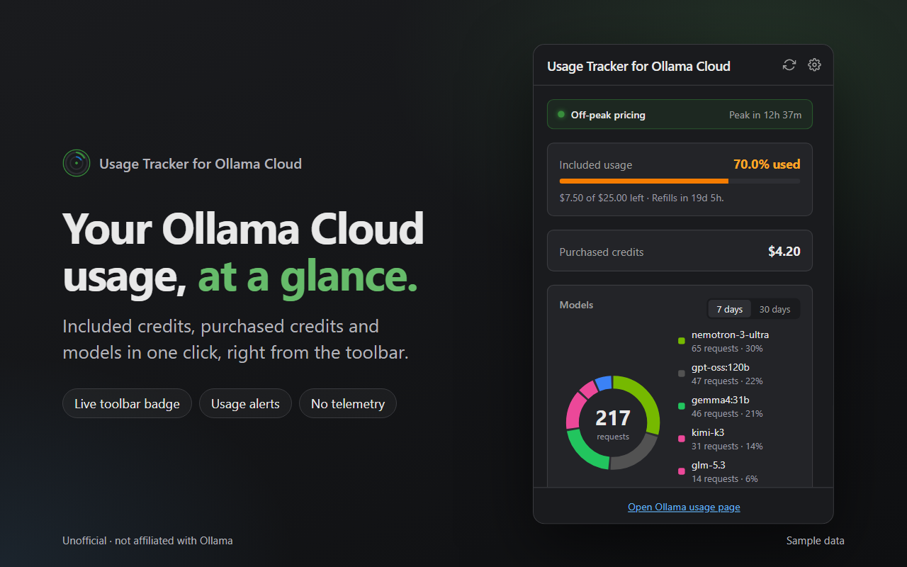

<div align="center">


# Usage Tracker for Ollama Cloud

**Your Ollama Cloud usage, at a glance.**
Credits, models and activity in one click, a live badge on the toolbar, and alerts before you hit the limit.

[](https://github.com/olaf-wilkosz/usage-tracker-for-ollama-cloud/actions/workflows/ci.yml)
[](https://github.com/olaf-wilkosz/usage-tracker-for-ollama-cloud/releases/latest)
[](LICENSE)


[Website](https://olaf-wilkosz.github.io/usage-tracker-for-ollama-cloud/) &middot;
[Download](https://github.com/olaf-wilkosz/usage-tracker-for-ollama-cloud/releases/latest) &middot;
[Privacy](https://olaf-wilkosz.github.io/usage-tracker-for-ollama-cloud/privacy.html)



</div>

> **Unofficial.** This is an independent project, not affiliated with or endorsed by Ollama. It uses Ollama's public, documented API.

## Features

- **Live toolbar badge**: a ring and a percentage, green / orange / red. Several usage windows (legacy plans) show as concentric rings.
- **Included and purchased credits**: what is left, when it refills, and your purchased balance.
- **Models breakdown**: requests per model over the last 7 or 30 days (7 days by default, like the usage page on ollama.com), with share and cost on hover; the busiest recent hours.
- **Activity heatmap**: last week by hour, last 30 days by day.
- **Alerts that don't nag**: warning and critical thresholds; one notification per cycle (again only on escalation or reset).
- **Peak / off-peak banner**: Ollama's published pricing hours, computed locally.
- **Accessible**: text and badge colors meet WCAG AA contrast, controls are labelled, and the heatmap comes with a text summary for screen readers. An automated axe-core audit (`npm run a11y`) covers the popup, the options page and the website.

## Install

The Chrome Web Store and Firefox Add-ons listings are on the way. Until then:

1. Download `usage-tracker-for-ollama-cloud-<version>-chrome.zip` from the [latest release](https://github.com/olaf-wilkosz/usage-tracker-for-ollama-cloud/releases/latest) and unzip it (or clone this repo and use the `extension/` folder).
2. Open `chrome://extensions` (or `edge://extensions`, `brave://extensions`), turn on **Developer mode**, click **Load unpacked** and pick the unzipped folder.
3. Click the extension icon (a setup page also opens on first install). Create an API key at [ollama.com/settings/keys](https://ollama.com/settings/keys), paste it into the popup (or the setup page) and click **Connect**. The popup closes when you switch tabs, so just reopen it after copying the key.
4. Pin the extension to the toolbar (extensions menu, then the pin) to keep the live badge in view; the popup reminds you until you do.

That is the whole setup.

**Firefox / Zen:** run `npm run build`, open `about:debugging#/runtime/this-firefox`, click **Load Temporary Add-on** and pick `dist/firefox/manifest.json` (until the AMO listing is live). If requests fail, check that the extension is allowed to access `ollama.com` under `about:addons` > the extension > Permissions.

## How it works

Every few minutes (you choose how often) the background worker makes three read-only requests to the official Ollama API:

| Request | Used for |
| --- | --- |
| `GET https://ollama.com/api/balance` | included credits (or legacy session / weekly windows) and purchased credits |
| `GET https://ollama.com/api/usage?range=24h&group_by=model` | recent activity by hour, hourly heatmap |
| `GET https://ollama.com/api/usage?range=30d&group_by=model` | models breakdown, daily heatmap |

That is far below the API's limit of 10 requests per minute. If the API is briefly unreachable, the last good numbers stay on screen, marked as stale.

## Privacy and security

- The only server contacted is `ollama.com`; requests are read-only, carry no cookies and no referrer. No analytics, no telemetry, no servers of ours.
- **Ollama API keys can't be limited to read-only**, so a key can also run models on your account. The extension keeps yours **encrypted at rest** (AES-GCM with a non-extractable key held in the extension's IndexedDB), sends it only to `ollama.com`, never shows it again and never logs it. You can remove it from the browser in one click and revoke it at ollama.com/settings/keys.
- Honest limit: encryption in the browser protects against copied storage files, backups and casual inspection, not against malware running as you. See [docs/architecture.md](docs/architecture.md#api-key-storage).
- Permissions: `storage`, `alarms`, `notifications`, and host access to `https://ollama.com/api/*` only.

Full policy: [privacy.html](https://olaf-wilkosz.github.io/usage-tracker-for-ollama-cloud/privacy.html). Report vulnerabilities as described in [SECURITY.md](SECURITY.md).

## Repository layout

```
extension/   the shipped extension (no build step, no runtime dependencies)
store/       Chrome Web Store / Firefox Add-ons listing text, screenshots, promo tiles
landing/     the website and privacy policy (published to GitHub Pages)
docs/        architecture and decisions
test/        unit and integration tests (node --test), real API responses as fixtures
scripts/     build, release checks, screenshot rendering, browser smoke test, preview server
.github/     CI, release and Pages workflows
```

## Development

Requires Node 22+.

```bash
npm ci
npm test            # unit + integration tests
npm run check       # release checks: versions, store limits, permissions, forbidden patterns
npm run build       # dist/chrome, dist/firefox and both zips
npm run preview     # popup and options page with sample data at http://localhost:8765/popup?scenario=busy
npm run render      # re-render store screenshots and promo tiles
npm run probe       # print what the API reports for YOUR account (needs OLLAMA_API_KEY) and check it for consistency
npm run a11y         # axe-core audit of popup, options page and website (needs Edge, Chrome or Brave)
npm run smoke -- "C:/Program Files (x86)/Microsoft/Edge/Application/msedge.exe"   # load the extension in a real browser
```

To work on the extension itself, load the `extension/` folder unpacked and click the reload icon after changes.

### Releasing

1. Bump the version in `extension/manifest.json` and `package.json` (CI fails if they differ) and add an entry to [CHANGELOG.md](CHANGELOG.md).
2. `git tag vX.Y.Z && git push --tags`. The release workflow checks that the tag matches the manifest, runs the tests, builds the Chrome and Firefox zips and attaches them to a GitHub Release.
3. Upload the zips to the stores ([store/README.md](store/README.md) has the checklist and the texts to paste).

## License

[MIT](LICENSE) &copy; Olaf Wilkosz
